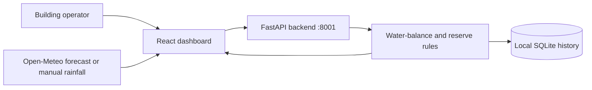

# JalLoop AutoReserve

**Forecast-aware water storage planning for buildings facing both water shortage and heavy rainfall.**

JalLoop AutoReserve is a hackathon prototype that helps a building operator reason about one practical trade-off: *how much tank capacity should be freed before a storm without using up the water needed for the next dry spell?* It combines rainfall inputs, tank capacity and level, daily demand, and a configurable reserve target to estimate a reserve-safe pre-storm drawdown, expected rainwater capture, and remaining overflow.

> **Prototype status:** JalLoop provides decision support, not autonomous water control. Sensor readings are simulated. No physical sensors, pumps, valves, or other actuators are connected. Water-balance and savings figures are estimates, not measured outcomes.

## The problem

Buildings can face two related water risks:

- **Dry spells and heatwaves:** using stored water to create storm capacity can leave a building short of water later.
- **Intense rainfall:** a nearly full tank may have too little headroom to retain incoming rain, causing overflow and sending water toward already stressed drains.

A useful decision should consider both risks at once, rather than simply draining the tank whenever rain is forecast or keeping it full at all times.

## What JalLoop does

1. **Builds a water-balance estimate.** Use a saved building scenario or enter rainfall, catchment area, runoff coefficient, tank capacity and current level, daily demand, and reserve days.
2. **Uses forecast data or manual input.** Search for a city and load Open-Meteo forecast information, or enter rainfall manually when a forecast is unavailable.
3. **Protects a configured reserve within the model.** The suggested drawdown cannot exceed the calculated difference between the current tank level and the reserve target.
4. **Shows the consequences.** Review estimated runoff, recommended drawdown, captured rain, overflow, projected tank level, remaining autonomy, and suggested water destinations.
5. **Keeps a local calculation history.** The FastAPI backend stores calculations in SQLite. If the backend is unavailable, the frontend has a local calculation fallback for demonstration.
6. **Explains the recommendation.** Rule-based modes distinguish dry-period defence, storm preparation, and balanced storage. Labels that resemble valve actions are displayed as recommendations only; they do not operate equipment.

## How the calculation works

All volumes are in litres (L).

- **Estimated runoff:** `rainfall_mm × catchment_area_m² × runoff_coefficient`
- **Reserve target:** `daily_water_demand_liters × reserve_days`
- **Existing headroom:** `max(0, tank_capacity_liters − current_water_level_liters)`
- **Headroom needed for the estimated runoff:** `max(0, estimated_runoff − existing_headroom)`
- **Maximum reserve-safe drawdown:** `max(0, current_water_level_liters − reserve_target)`
- **Suggested drawdown:** the smaller of the headroom needed and the maximum reserve-safe drawdown
- **Captured rain:** the smaller of estimated runoff and the available tank space after the suggested drawdown
- **Estimated overflow:** `max(0, estimated_runoff − space_available_after_drawdown)`

The unit relationship used is that **1 mm of rain over 1 m² equals 1 litre** before applying the runoff coefficient. The model assumes the entered or forecast rainfall is representative and that the tank is not otherwise filled or drawn during the calculation. It does not simulate rainfall intensity, first-flush losses, evaporation, site drainage, pump limits, or all real-world hydrology. A modelled reserve is not a guarantee of real-world water availability.

## Example: Bangalore high-rise preset

The included demonstration scenario uses these inputs: 65 mm rainfall, 2,401 m² catchment, runoff coefficient 0.90, 150,000 L tank capacity, 115,000 L current tank level, 18,000 L/day demand, and a 3.5-day reserve.

| Result | Model estimate |
|---|---:|
| Incoming harvestable runoff | 140,458.5 L |
| Existing tank headroom | 35,000 L |
| Reserve target | 63,000 L |
| Suggested pre-storm drawdown | 52,000 L |
| Suggested average rate over the model's 4-hour window | 216.7 L/min |
| Rainwater captured after drawdown | 87,000 L |
| Remaining estimated overflow | 53,458.5 L |

**Why the overflow matters:** After the maximum reserve-safe drawdown, the model estimates space for 87,000 L of the 140,458.5 L runoff. The remaining 53,458.5 L is still expected to overflow. JalLoop surfaces this constraint instead of claiming it can prevent all flooding.

The dashboard also presents water reuse, tanker-equivalent volume, and cost-savings estimates. Those values use assumptions, including 10,000 L per tanker and a benchmark of ₹1,500 per tanker; they are not measured savings or guaranteed financial results.

## Decision modes

The backend uses a deterministic, rules-based decision engine. The order of checks matters: the dry-period condition takes priority.

| Mode | Trigger in the current implementation | Example advisory label |
|---|---|---|
| `HEATWAVE_DEFENSE` | Forecast rainfall is below 10 mm, or current tank level is below the reserve target | `KEEP_CLOSED` |
| `STORM_SURGE_PREP` | Rainfall is at least 40 mm, or estimated overflow is positive, or a drawdown is recommended | `CONTROLLED_DISCHARGE`, `EMERGENCY_BYPASS`, or `MAX_HARVEST_OPEN`, depending on the calculated scenario |
| `BALANCED_BUFFER` | Neither earlier condition applies | `KEEP_CLOSED` |

These labels are advisory outputs in the UI/API only. The prototype does not issue commands to real valves, pumps, or building-management equipment. A facility operator would need to assess site conditions, permissions, water quality, and equipment limits before acting on any recommendation.

## Technology and architecture

- **Frontend:** React, Vite, JavaScript, Tailwind CSS, and Recharts.
- **Backend:** Python, FastAPI, and Uvicorn.
- **Local persistence:** SQLite calculation history.
- **Weather:** Open-Meteo forecast API; city search and manual rainfall fallback.
- **AWS tooling:** AWS Serverless Application Model (SAM) CLI and a SAM template for a possible serverless deployment path.



**Current running architecture:** React + FastAPI + local SQLite. The AWS template is a separate deployment path, not a live connection from the current dashboard.

## AWS use and verification

JalLoop uses the **AWS SAM CLI locally** for the hackathon's AWS open-source-tool path. The repository includes `backend/template.yaml`, which describes a target serverless architecture using:

- AWS Lambda to run the FastAPI application through Mangum;
- Amazon API Gateway HTTP API as the API entry point; and
- Amazon DynamoDB for calculation records.

**Verified locally:** SAM template validation and `sam build` completed successfully. **Not completed:** deployment to an AWS account and end-to-end testing of the deployed Lambda, API Gateway, and DynamoDB stack. The currently running application uses SQLite; do not interpret the template as proof of a live AWS deployment.

To repeat the local template checks (from the `backend` folder, with AWS SAM CLI installed):

```bash
sam validate --template-file template.yaml --region ap-south-1 --lint
sam build --template-file template.yaml --no-use-container
```


## Run locally

**Prerequisites:** Python 3.11 or compatible, Node.js, npm, and Git. Use the explicit commands below to run the backend on **port 8001**.

### 1. Start the backend

From the repository root:

```powershell
python -m pip install -r backend/requirements.txt
python -m uvicorn app.main:app --app-dir backend --host 127.0.0.1 --port 8001 --reload
```

API documentation: <http://127.0.0.1:8001/docs>

### 2. Point the frontend to port 8001

Open a second terminal at the repository root and create `frontend/.env.local`:

```powershell
Set-Content -Path frontend/.env.local -Value "VITE_API_BASE_URL=http://127.0.0.1:8001"
```

Then run the frontend:

```powershell
cd frontend
npm install
npm run dev
```

Open <http://localhost:5173>. Restart the Vite dev server after changing `.env.local`. The `.env.local` file is for local configuration and should not be committed. The convenience runner scripts in the repository may use port 8000 by default; use the explicit commands above when running on port 8001.

### Weather fallback

Open-Meteo access can fail because of network connectivity, rate limits, or service errors. When that happens, use the dashboard's manual rainfall input. Forecast values are third-party weather data, not official IMD observations or warnings.

## Tests and build checks

The following checks passed in the latest recorded local verification:

| Check | Result |
|---|---|
| Backend test suite | 12 tests passed |
| Frontend lint | 0 warnings and 0 errors |
| Frontend production build | Successful; Vite reported a large-bundle warning, which did not fail the build |
| AWS SAM template validation | Successful |
| AWS SAM build without Docker/container | Successful |


Repeat the checks from the repository root:

```powershell
python -m pytest backend/tests -v
npm run lint --prefix frontend
npm run build --prefix frontend
```

SAM checks are listed in the AWS section above. A successful local template build is not the same as a deployed-service integration test.

## Limitations and next steps

- No live sensors or physical control hardware are connected; telemetry is simulated.
- The application is a prototype and has not been validated for safety-critical or operational water management.
- Rainfall totals and runoff estimates do not capture all site-specific drainage and hydrology factors.
- Water reuse, tanker-equivalent volume, and rupee savings are assumption-based estimates.


A practical next step would be a controlled pilot with a building operator, calibrated tank-level and rain sensors, site-specific hydrology data, and human approval before any physical actuation is considered.

## Data attribution

Weather forecast information is provided by [Open-Meteo](https://open-meteo.com/). Attribute Open-Meteo and review its [terms of use](https://open-meteo.com/en/terms) and [CC BY 4.0](https://creativecommons.org/licenses/by/4.0/) requirements. The free API is subject to non-commercial-use conditions; check the current terms for your own use case.


