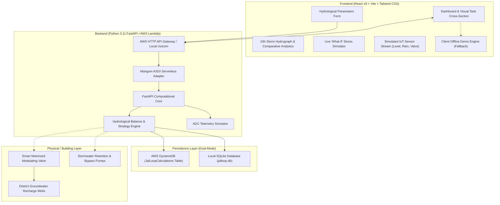

# 💧 JalLoop AutoReserve

> **Intelligent Urban Water Management System Reconciling Cloudburst Flood Protection with Heatwave & Drought Reserves.**


---

## 📌 Executive Summary

Every growing metropolis faces an urban water dilemma:
1. **Heatwaves & Dry Spells:** Buildings experience severe shortages and pay exorbitant sums for municipal water tankers.
2. **Cloudbursts & Monsoons:** Rainwater harvesting tanks are left full prior to storms. When torrential rains arrive, clean rainwater violently overflows onto street drains, overwhelming municipal stormwater networks and triggering localized urban flooding.

**The Dilemma:**
If a facility manager drains their tank blindly before a storm that ends up failing or underperforming, the building suffers an artificial drought. If they hold all water, the incoming storm surge overflows and causes flood damage.

**The Solution:**
**JalLoop AutoReserve** is an intelligent, dual-objective water-balancing system that calculates the mathematically optimal **Pre-Storm Drawdown** while **strictly guarding a multi-day dry-period safety reserve**.

---

## 🏗️ System Architecture



---

## 🧮 Mathematical Formulas & Principles

### 1. Harvestable Runoff Volume
$$V_{\text{runoff}} = \text{Rainfall (mm)} \times \text{Catchment Area (m²)} \times C$$

*Unit Proof:*
$$1\text{ mm} = 0.001\text{ m}$$
$$1\text{ mm} \times 1\text{ m}^2 = 0.001\text{ m}^3 = 1.000\text{ Liter}$$
Therefore, **$1\text{ mm}$ of rain over $1\text{ m}^2$ yields exactly $1\text{ Liter}$ of water**.

### 2. Guaranteed Dry-Period Safety Reserve
$$V_{\text{reserve}} = \text{Daily Water Demand (L/day)} \times \text{Target Reserve Days}$$

### 3. Available Storage Headroom
$$V_{\text{available}} = \max(0, \text{Tank Capacity} - \text{Current Water Level})$$

### 4. Storage Room Needed to Absorb Storm
$$V_{\text{needed}} = \max(0, V_{\text{runoff}} - V_{\text{available}})$$

### 5. Maximum Permissible Drawdown
AutoReserve strictly enforces that drawdown **never** breaches the safety reserve:
$$V_{\text{max\_drawdown}} = \max(0, \text{Current Water Level} - V_{\text{reserve}})$$

### 6. Recommended Pre-Storm Drawdown
$$V_{\text{drawdown}} = \min(V_{\text{needed}}, V_{\text{max\_drawdown}})$$

### 7. Post-Rain Water Balance
$$V_{\text{post\_drawdown}} = \text{Current Water Level} - V_{\text{drawdown}}$$
$$V_{\text{captured}} = \min(V_{\text{runoff}}, \text{Capacity} - V_{\text{post\_drawdown}})$$
$$V_{\text{overflow}} = \max(0, V_{\text{runoff}} - (\text{Capacity} - V_{\text{post\_drawdown}}))$$
$$V_{\text{post\_rain}} = V_{\text{post\_drawdown}} + V_{\text{captured}}$$

---

## 🧠 Decision Engine Modes

| Operating Mode | Trigger Condition | Automated Actuator Directive |
| :--- | :--- | :--- |
| **HEATWAVE_DEFENSE** | Rain $< 10\text{ mm}$ or Current Level $< \text{Reserve}$ | **KEEP_CLOSED** (0 LPM). Zero release. Ration non-potable use. Activate graywater loop. |
| **STORM_SURGE_PREP** | Rain $\ge 40\text{ mm}$ or Runoff $>$ Headroom | **CONTROLLED_DISCHARGE** at calculated LPM to recharge pits over 4 hours before storm onset. |
| **BALANCED_BUFFER** | Moderate rain fitting existing headroom | **KEEP_CLOSED**. Harvest 100% naturally with zero spillage. |
| **EMERGENCY_BYPASS** | Runoff exceeds total headroom after max safe drawdown | **EMERGENCY_BYPASS**. Engage high-capacity stormwater pumps to prevent basement flood. |

---

## 🚀 Quickstart & Local Run

### Prerequisites
- **Node.js** (v18+)
- **Python** (v3.10+)

### Option 1: One-Click Run
Run the appropriate script from the repository root:

- **Windows (PowerShell):**
  ```powershell
  .\run_local.ps1
  ```
- **Windows (Command Prompt):**
  ```cmd
  run_local.bat
  ```
- **Linux / macOS:**
  ```bash
  chmod +x run_local.sh
  ./run_local.sh
  ```

### Option 2: Manual Terminal Execution

#### 1. Backend Setup:
```bash
cd backend
python -m pip install -r requirements.txt
python -m pytest tests -v     # Verify all unit & API tests pass
python -m uvicorn app.main:app --port 8000 --reload
```
API Documentation will be live at: `http://localhost:8000/docs`

#### 2. Frontend Setup:
In a separate terminal:
```bash
cd frontend
npm install
npm run dev
```
Dashboard will be live at: `http://localhost:5173`

---

## ☁️ Real AWS Cloud Integration & Deployment

JalLoop AutoReserve is built from day one for production AWS serverless architecture:

### 1. Dual-Mode Storage Architecture
- **Production AWS Mode:** If AWS credentials (`AWS_ACCESS_KEY_ID`, `AWS_SECRET_ACCESS_KEY`) are present, the backend automatically connects to **AWS DynamoDB** table `JalLoopCalculations` using `boto3`.
- **Local Fallback Mode:** If unconfigured, the app transparently stores all calculations in local SQLite database `jalloop.db`.
- **Client Demo Mode:** If the backend is offline, the React frontend executes an in-browser mirror of the calculation engine.

### 2. AWS Serverless Deployment (AWS SAM)
The repository includes an AWS SAM template (`backend/template.yaml`) provisioning:
- **AWS DynamoDB Table:** `JalLoopCalculations` with Pay-Per-Request billing and encryption.
- **AWS Lambda Function:** Python 3.11 running FastAPI via Mangum.
- **AWS HTTP API Gateway:** Direct REST/HTTP routing to the Lambda function.

To deploy to your AWS account:
```bash
cd backend
# 1. Build serverless artifacts
sam build

# 2. Deploy to AWS
sam deploy --guided --stack-name jalloop-autoreserve-stack --region us-east-1
```

Or run the automated deployment script:
- PowerShell: `.\backend\deploy_aws.ps1`
- Bash: `./backend/deploy_aws.sh`

---

## 🧪 Verification & Test Suite

The project includes unit and integration tests covering runoff math, edge cases, safety reserve boundaries, and API routes:

```bash
cd backend
python -m pytest tests -v
```

**Results:**
- `test_accurate_runoff_formula` ✅ PASSED
- `test_pre_storm_drawdown_calculation` ✅ PASSED
- `test_safety_reserve_never_breached` ✅ PASSED
- `test_heatwave_drought_mode` ✅ PASSED
- `test_zero_rainfall` ✅ PASSED
- `test_root_endpoint` ✅ PASSED
- `test_health_endpoint` ✅ PASSED
- `test_presets_endpoint` ✅ PASSED
- `test_calculate_endpoint` ✅ PASSED
- `test_history_endpoint` ✅ PASSED
- `test_sensors_endpoint` ✅ PASSED

Frontend production build verification:
```bash
cd frontend
npm run build
```
Output: `✓ built in 1.54s` without any errors.

---

## 📊 Live Built-in Features

1. **Dynamic Visual Tank Cross-Section:** Animated SVG showing real-time water levels, pre-storm drawdown zone, safety reserve boundary line, and overflow spill indicator.
2. **Tabbed Parameters Form:** Configure storm depth, roof area, surface runoff coefficient, tank capacity, daily demand, and reserve days with instant presets.
3. **Smart Decision Engine:** Real-time strategy recommendation with automated actuator discharge rates (LPM).
4. **Interactive 24h Hydrograph:** Visualizes hourly rainfall distribution against tank level curves.
5. **JalLoop vs Conventional Comparison:** Shows how much flood water is prevented from spillage.
6. **Live What-If Stress Simulator:** Real-time slider testing drought shifts (-90%) and cloudbursts (+150%).
7. **Simulated IoT Sensor Network:** Live ultrasonic level transmitter, tipping rain gauge, flow turbine, and ambient weather telemetry.
8. **Audit Trail & CSV Export:** Complete calculation history with one-click scenario re-loading and CSV download.

---

## ⚖️ License
MIT License. Built for the Hackathon.
